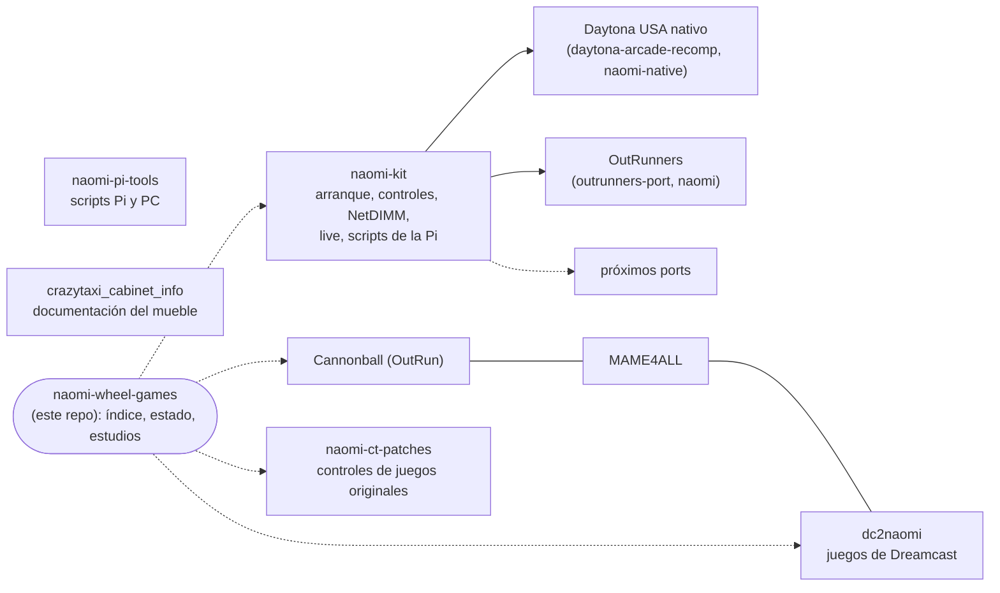

# Naomi Wheel Games — juegos de volante, moto y spinner para un mueble Crazy Taxi (NAOMI + NetDIMM)

> 🇬🇧 **English:** [the English version is at the end of this page ↓](#english)

Objetivo: reunir **el máximo número de juegos de coches, motos y spinner** que se puedan arrancar por
**netboot (NetDIMM)** en un mueble **Crazy Taxi NAOMI** con sus controles originales, y documentarlo
todo para que otros usuarios (y otras IAs) puedan reutilizar el trabajo.

> **Política de ROMs:** este repositorio **no contiene ROMs** ni binarios que las incluyan.
> Solo hay código, herramientas, parches y documentación. Cada usuario genera sus `.bin`
> a partir de sus propios volcados.

---

## Repositorios del proyecto

| Repositorio | Qué es | Traspaso |
|---|---|---|
| [mame4all-naomi](https://github.com/0skarzer0/mame4all-naomi) | MAME4ALL (MAME 0.35) para NAOMI: Hang-On, Konami GT… | [HANDOFF.md](https://github.com/0skarzer0/mame4all-naomi/blob/naomi/HANDOFF.md) |
| [dreamcast-cannonball](https://github.com/0skarzer0/dreamcast-cannonball/tree/naomi) (rama `naomi`) | Cannonball (OutRun) para NAOMI | [naomi/HANDOFF.md](https://github.com/0skarzer0/dreamcast-cannonball/blob/naomi/naomi/HANDOFF.md) |
| [daytona-arcade-recomp](https://github.com/0skarzer0/daytona-arcade-recomp/tree/naomi) (rama `naomi`) | *Histórico, sin mantenimiento:* recompilación de Daytona USA (Model 2) para NAOMI; la sustituyó el port nativo (fila siguiente), que ya funciona. En la rama `naomi-native` esa carpeta se eliminó (último commit que la tiene: `b9fda30`) | [platform/dreamcast/HANDOFF.md](https://github.com/0skarzer0/daytona-arcade-recomp/blob/naomi/platform/dreamcast/HANDOFF.md) |
| [daytona-arcade-recomp](https://github.com/0skarzer0/daytona-arcade-recomp/tree/naomi-native) (rama `naomi-native`) | **Port nativo** de Daytona USA (reescrito en C para SH-4, PR #58 del original) para NAOMI | [platform/dreamcast-native/naomi/HANDOFF.md](https://github.com/0skarzer0/daytona-arcade-recomp/blob/naomi-native/platform/dreamcast-native/naomi/HANDOFF.md) |
| [dc2naomi](https://github.com/0skarzer0/dc2naomi) | Cargador de juegos de Dreamcast en NAOMI (experimental) | [HANDOFF.md](https://github.com/0skarzer0/dc2naomi/blob/main/HANDOFF.md) |
| [naomi-ct-patches](https://github.com/0skarzer0/naomi-ct-patches) | Parches de controles (IPS) para juegos NAOMI / NAOMI 2 / Atomiswave en el mueble Crazy Taxi, y lector de tarjetas virtual (Initial D) | [HANDOFF.md](https://github.com/0skarzer0/naomi-ct-patches/blob/main/HANDOFF.md) |
| [model1-naomi](https://github.com/0skarzer0/model1-naomi) | Virtua Racing (Sega Model 1) en NAOMI: estudio de viabilidad | [HANDOFF.md](https://github.com/0skarzer0/model1-naomi/blob/main/HANDOFF.md) |
| [outrunners-port](https://github.com/0skarzer0/outrunners-port/tree/naomi) (rama `naomi`) | **OutRunners** para NAOMI: fork de [cheviman/outrunners-port](https://github.com/cheviman/outrunners-port); el port en `ports/naomi/` | [ports/naomi/HANDOFF.md](https://github.com/0skarzer0/outrunners-port/blob/naomi/ports/naomi/HANDOFF.md) (y el estudio: [ports/naomi/docs/study.md](https://github.com/0skarzer0/outrunners-port/blob/naomi/ports/naomi/docs/study.md)) |
| [naomi-pi-tools](https://github.com/0skarzer0/naomi-pi-tools) | Scripts de la Raspberry y del PC: enviar juegos, parar el VMU, timehack, `live.py`, añadir filas a `romsinfo.csv` | [HANDOFF](https://github.com/0skarzer0/naomi-pi-tools/blob/main/HANDOFF.md) |
| [crazytaxi_cabinet_info](https://github.com/0skarzer0/crazytaxi_cabinet_info) | Solo documentación del mueble: JVS, valores de volante y pedales, trampas del hardware real | [HANDOFF](https://github.com/0skarzer0/crazytaxi_cabinet_info/blob/main/HANDOFF.md) |
| [naomi-kit](https://github.com/0skarzer0/naomi-kit) | Librería común de los ports nativos a NAOMI: arranque, volante y monedas, ficheros de la NetDIMM, bloque «live», accesos desalineados y scripts de la Pi | [HANDOFF del kit](https://github.com/0skarzer0/naomi-kit/blob/main/HANDOFF.md) |


### Cómo encaja todo



Daytona nativo y OutRunners son los que están o estarán sobre `naomi-kit` (OutRunners ya lo usa; Daytona nativo
sigue con su copia del código, pendiente de pasarlo). Los demás son proyectos independientes.

### Estado de un vistazo

| Juego | Estado | Notas |
|---|---|---|
| Juegos originales NAOMI / NAOMI 2 / Atomiswave | ✅ | [docs/pi60-juegos.md](docs/pi60-juegos.md) |
| Daytona USA nativo | ✅ 60 fps | |
| Cannonball (OutRun) | ✅ 60 fps | |
| Super Sprint (MAME4ALL) | ✅ 60 fps | |
| Juegos de Dreamcast con dc2naomi | ✅ varios · 🧪 otros | ver «Estado» |
| OutRunners | 🧪 | imagen a ~60 fps; sonido, sombras y START=moneda sin probar en placa |
| Hang-On, Konami GT (MAME4ALL) | ⚠️ | ~46 fps y cuelgues |
| Virtua Racing (model1-naomi) | estudio | nada jugable |

✅ funciona en placa · 🧪 subido, sin probar · ⚠️ con problemas.

### Cómo retomar el trabajo en un chat nuevo (personas o IAs)

0. Para añadir un juego o colaborar: [CONTRIBUTING.md](CONTRIBUTING.md).
1. Lee este README para la visión general.
2. Lee el `HANDOFF.md` del repositorio en el que vas a trabajar: estado, arquitectura, direcciones,
   cómo compilar y siguientes pasos.
3. Al terminar la sesión, actualiza ese `HANDOFF.md` y, si cambia el estado de algún juego,
   [docs/pi60-juegos.md](docs/pi60-juegos.md) y el apartado "Estado" de aquí. Lo que deje de ser actual pasa a
   [docs/historial.md](docs/historial.md), con su fecha.

## Estado (2026-11-13)

Qué está cargado en la Raspberry del mueble y qué está probado en placa, juego a juego: **[docs/pi60-juegos.md](docs/pi60-juegos.md)**.

- **Funcionan en placa:** los juegos originales de NAOMI / NAOMI 2 / Atomiswave del mueble; **Daytona USA nativo**
  y **Cannonball (OutRun)** a 60 fps; **Super Sprint** (MAME4ALL) a 60 fps; y con **dc2naomi**, Crazy Taxi 2, Namco
  Museum (Pole Position), Daytona USA 2001, F355 Challenge, 18 Wheeler, Sega Rally 2 y los cinco juegos de Yu Suzuki
  Game Works, todos con su VMU guardada en la Raspberry; y **Mario Kart 64** (port de Dreamcast, sin VMU todavía).
- **En curso:** **OutRunners** (port nativo): imagen por la PowerVR2 a 60 fps en placa; sombras, fundidos exactos,
  sonido en el AICA y un conversor para Windows hechos y sin probar en placa ([HANDOFF](https://github.com/0skarzer0/outrunners-port/blob/naomi/ports/naomi/HANDOFF.md)).
- **Subidos, sin probar en placa:** una docena de juegos de Dreamcast convertidos con dc2naomi (Test Drive 6, Star
  Wars Racer, Metropolis Street Racer, SF Rush 2049, la demo de OutRun 2006 de ArkRetro…) y los
  parches de 18 Wheeler e Initial D (con lector de tarjetas virtual, ya arrancando en placa; falta ver que da y graba la
  tarjeta). Los dos cuelgan en el attract con la BIOS multirregión de la placa aunque no estén parcheados ([detalle](docs/pi60-juegos.md)).
- **Free play y attract sin sonido** puestos en la cabecera de 49 de las 50 imágenes de la Raspberry (2026-11-13).
- **Lentos en placa:** Hang-On y Konami GT (MAME4ALL), ~46 fps y cuelgues.
- **Estudio:** model1-naomi (¿puede el SH-4 emular el V60 de Virtua Racing?), nada jugable todavía.

## Siguientes pasos

1. **OutRunners:** probar en placa la imagen con sonido, sombras y fundidos; luego el conversor para Windows.
2. **Probar en placa** los juegos de Dreamcast convertidos que faltan y los parches de 18 Wheeler e Initial D.
   Antes, **actualizar la BIOS multirregión** (v2.01, rev C/H) o confirmar su versión: sin eso 18 Wheeler e Initial D se
   cuelgan en el attract.
3. **Estándar de controles común** para todos los juegos del mueble (moneda, START, vista, menú): hay una
   [propuesta](https://github.com/0skarzer0/naomi-kit/blob/main/docs/controls.md); hoy cada port lo
   resuelve a su manera (OutRunners: START = moneda; MAME4ALL: START pulsado = crédito, al soltar = START; Cannonball: freno + START = menú).
4. **MAME4ALL:** Hang-On y Konami GT lentos en placa; añadir los drivers fáciles de [docs/juegos.md](docs/juegos.md)
   (Super Hang-On, Enduro Racer, Spy Hunter, Turbo, Arkanoid…).
5. **Más allá:** un frontend común tipo libretro para NAOMI (mame2000, mame2003, fbalpha2012) para los juegos de
   [docs/investigacion.md](docs/investigacion.md).

## Documentación

Cada documento está en español con su traducción al inglés al final.

| Documento | Qué hay |
|---|---|
| [docs/pi60-juegos.md](docs/pi60-juegos.md) | Juego a juego, qué hay en la Raspberry del mueble y su estado en placa |
| [docs/juegos.md](docs/juegos.md) | Catálogo por niveles de dificultad: nativos de NAOMI, ports propios, recopilatorios de Dreamcast, parches |
| [docs/hardware.md](docs/hardware.md) | El mueble: placa, carga, valores JVS de volante y pedales, trampas del hardware real |
| [docs/investigacion.md](docs/investigacion.md) | Versiones de MAME/FBA candidatas, arquitectura del port MAME4ALL, decompilaciones y recompilaciones |
| [docs/crazy-taxi-dreamcast-vs-naomi.md](docs/crazy-taxi-dreamcast-vs-naomi.md) | Qué cambió SEGA entre el Crazy Taxi de Dreamcast y el de NAOMI |
| [docs/historial.md](docs/historial.md) | Estados y pendientes antiguos, con su fecha |

## Contenido del repositorio

```
naomi-wheel-games/
├── README.md        ← este documento
├── CONTRIBUTING.md  ← cómo añadir un juego o documentar
├── .github/         ← comprobación de enlaces
└── docs/            ← la documentación de arriba
```

El código, el HANDOFF y los estudios de cada proyecto están en su repositorio (tabla de arriba); OutRunners incluido
(se movió a su fork el 2026-11-13).

## Hardware de referencia

| Elemento | Detalle |
|---|---|
| Placa | NAOMI 2 con multibios (también vale NAOMI 1 para casi todo) |
| Carga | NetDIMM 512 MB, netboot desde Raspberry Pi 3 con **WiPi Netbooter** (`.bin.gz` + línea en `romsinfo.csv`) |
| Monitor | 31 kHz (VGA 640x480) |
| Controles | Volante analógico (~270°), acelerador, freno, palanca de 2 posiciones con retorno (adelante/atrás), START, monedero |

Detalle, valores medidos y consecuencias para cada tipo de juego: [docs/hardware.md](docs/hardware.md).

---

## Aviso legal

- No se distribuyen ROMs, BIOS ni binarios que las contengan.
- Las marcas pertenecen a sus propietarios (Sega, Konami, Atari, Namco, Midway, Taito…). OutRunners es una
  marca de SEGA; ningún proyecto de aquí está afiliado a SEGA ni respaldado por ella.
- Los proyectos de terceros (decompilaciones, Cannonball, MAME, FBA) mantienen sus licencias;
  MAME 0.35/0.37/0.78 y FBA antiguo tienen **licencias no comerciales**: **no se pueden vender ni incluir en un
  producto de pago**, y quien redistribuya un port basado en ellos debe respetarlo y conservar sus avisos.

---

## Agradecimientos

Este proyecto solo adapta al mueble el trabajo de otras personas; todo lo siguiente lo ha hecho posible, de forma
directa o como inspiración o ayuda indirecta. Si falta alguien, abrid una issue y se añade.

- **alphanu1** ([daytona-arcade-recomp](https://github.com/alphanu1/daytona-arcade-recomp)) y **dfchil**, autor del port
  nativo de Daytona USA (PR #58) y de [enDjinn](https://github.com/dfchil/enDjinn),
  [AICAflow](https://github.com/dfchil/aicaflow) y [AICAforge](https://github.com/dfchil/AICAforge). Daytona nativo
  en NAOMI es su juego funcionando en otra placa. Detalle en el
  [README de la rama `naomi-native`](https://github.com/0skarzer0/daytona-arcade-recomp/blob/naomi-native/platform/dreamcast-native/naomi/README.md#acknowledgements).
- **DragonMinded**: [libnaomi](https://github.com/DragonMinded/libnaomi) (lectura por el puerto de cartucho y protocolo
  de peek / poke de la NetDIMM), las herramientas de netboot (`netdimm.py`, `netdimm_send`) y el repositorio de netboot
  con `attach_sram`.
- **El equipo y los colaboradores de KallistiOS**, con su subarquitectura NAOMI y `naomibintool`, base de todos los
  ports nativos de este proyecto; y los proyectos **GNU binutils, GCC y newlib**, que forman la toolchain `sh-elf`.
- **El WiPi Netbooter y Piforce / [Piforce-Web](https://github.com/dev-tty0/Piforce-Web)**, que a su vez usan las
  herramientas Triforce de debugmode: la Raspberry Pi que arranca la placa por red.
- **Darksoft**, por las conversiones AW2NAOMI de Atomiswave.
- **Chris White**, autor de **Cannonball** (OutRun), y quienes lo portaron a Dreamcast, de donde parte el port a NAOMI
  ([dreamcast-cannonball](https://github.com/0skarzer0/dreamcast-cannonball)).
- **El equipo de MAME y los autores de MAME4ALL, mame2000, mame2003 y FBA**, base del port de arcades clásicos.
- **Flycast** y sus colaboradores, el emulador con el que se prueba antes de subirlo a la placa.
- **[ArkRetro](https://github.com/ArkRetro)**, autor de la demo de OutRun 2006 Coast 2 Coast para Dreamcast que se juega en el
  mueble con dc2naomi.
- **[bucanero](https://github.com/bucanero)** ([dreamcast-saves](https://github.com/bucanero/dreamcast-saves)): las partidas
  desbloqueadas que llevan en su VMU los juegos de Dreamcast del mueble. El resto de lo que usa dc2naomi está en sus
  [agradecimientos](https://github.com/0skarzer0/dc2naomi#agradecimientos).
- **gyrovorbis** ([SH4ZAM](https://github.com/gyrovorbis/sh4zam)) y **la comunidad de vgmrips**, cuyo pack de música de
  Daytona USA (Sega Model 2) es lo que suena en el port.
- **Los autores de los proyectos de [investigacion.md](docs/investigacion.md)** que sirven de referencia o futura base: cheviman (OutRunners port y su descompilación; Aaron Giles, por ymfm, en el que se basa su YM3438),
  wanszai (Scud Race, Ridge Racer Collection, Sega Rally), namco22-decompile, la decompilación de Ridge Racer (PSX), el
  port de Wipeout a Dreamcast, mk64-dc, Wave Race 64 DC y la decompilación de Sonic R.
- **Claude** (Anthropic), a través de Claude Code: el código y la documentación de los ports de este proyecto se han
  escrito y depurado con Claude en sesiones con el propietario del mueble, que es quien prueba cada imagen en la placa
  y aporta las fotos y las mediciones de las que sale cada diagnóstico.

Los nombres que aparecen aquí se conocen por los repositorios y las páginas citadas; las licencias de cada proyecto
siguen siendo las suyas (Aviso legal).

---

## English

*Translation of the Spanish text above. If the two ever disagree, the Spanish one is the up-to-date one.*

### Naomi Wheel Games — wheel, bike and spinner games for a Crazy Taxi cabinet (NAOMI + NetDIMM)

Goal: gather **as many car, bike and spinner games as possible** that can be started by **netboot (NetDIMM)** on a
**Crazy Taxi NAOMI** cabinet with its original controls, and document everything so that other users (and other
AIs) can reuse the work.

> **ROM policy:** this repository **contains no ROMs** and no binaries that include them. There is only code, tools,
> patches and documentation. Every user builds their own `.bin` files from their own dumps.

#### The project's repositories

| Repository | What it is | Handoff |
|---|---|---|
| [mame4all-naomi](https://github.com/0skarzer0/mame4all-naomi) | MAME4ALL (MAME 0.35) for the NAOMI: Hang-On, Konami GT… | [HANDOFF.md](https://github.com/0skarzer0/mame4all-naomi/blob/naomi/HANDOFF.md) |
| [dreamcast-cannonball](https://github.com/0skarzer0/dreamcast-cannonball/tree/naomi) (branch `naomi`) | Cannonball (OutRun) for the NAOMI | [naomi/HANDOFF.md](https://github.com/0skarzer0/dreamcast-cannonball/blob/naomi/naomi/HANDOFF.md) |
| [daytona-arcade-recomp](https://github.com/0skarzer0/daytona-arcade-recomp/tree/naomi) (branch `naomi`) | *Historical, unmaintained:* static recompilation of Daytona USA (Model 2) for the NAOMI, replaced by the native port (next row), which already works | [platform/dreamcast/HANDOFF.md](https://github.com/0skarzer0/daytona-arcade-recomp/blob/naomi/platform/dreamcast/HANDOFF.md) |
| [daytona-arcade-recomp](https://github.com/0skarzer0/daytona-arcade-recomp/tree/naomi-native) (branch `naomi-native`) | **Native port** of Daytona USA (rewritten in C for the SH-4, PR #58 of the original) for the NAOMI | [platform/dreamcast-native/naomi/HANDOFF.md](https://github.com/0skarzer0/daytona-arcade-recomp/blob/naomi-native/platform/dreamcast-native/naomi/HANDOFF.md) |
| [dc2naomi](https://github.com/0skarzer0/dc2naomi) | Loader that runs Dreamcast games on the NAOMI (experimental) | [HANDOFF.md](https://github.com/0skarzer0/dc2naomi/blob/main/HANDOFF.md) |
| [naomi-ct-patches](https://github.com/0skarzer0/naomi-ct-patches) | Control patches (IPS) for NAOMI / NAOMI 2 / Atomiswave games on the Crazy Taxi cabinet, and a virtual card reader (Initial D) | [HANDOFF.md](https://github.com/0skarzer0/naomi-ct-patches/blob/main/HANDOFF.md) |
| [model1-naomi](https://github.com/0skarzer0/model1-naomi) | Virtua Racing (Sega Model 1) on the NAOMI: feasibility study | [HANDOFF.md](https://github.com/0skarzer0/model1-naomi/blob/main/HANDOFF.md) |
| [outrunners-port](https://github.com/0skarzer0/outrunners-port/tree/naomi) (branch `naomi`) | **OutRunners** for the NAOMI: fork of [cheviman/outrunners-port](https://github.com/cheviman/outrunners-port); the port is in `ports/naomi/` | [ports/naomi/HANDOFF.md](https://github.com/0skarzer0/outrunners-port/blob/naomi/ports/naomi/HANDOFF.md) (and the study: [ports/naomi/docs/study.md](https://github.com/0skarzer0/outrunners-port/blob/naomi/ports/naomi/docs/study.md)) |
| [naomi-kit](https://github.com/0skarzer0/naomi-kit) | Shared library of the native NAOMI ports: boot, wheel and coins, NetDIMM files, "live" block, misaligned accesses and Raspberry Pi scripts | [the kit's HANDOFF](https://github.com/0skarzer0/naomi-kit/blob/main/HANDOFF.md) |

Native Daytona and OutRunners are the ones that are or will be built on `naomi-kit` (OutRunners already uses it;
native Daytona still has its own copy of the code, to be moved over). The others are independent projects.

#### Status at a glance

| Game | Status | Notes |
|---|---|---|
| Original NAOMI / NAOMI 2 / Atomiswave games | ✅ | [docs/pi60-juegos.md](docs/pi60-juegos.md) |
| Native Daytona USA | ✅ 60 fps | |
| Cannonball (OutRun) | ✅ 60 fps | |
| Super Sprint (MAME4ALL) | ✅ 60 fps | |
| Dreamcast games with dc2naomi | ✅ several · 🧪 others | see "Status" |
| OutRunners | 🧪 | picture at ~60 fps; sound, shadows and START = coin not yet tested on the board |
| Hang-On, Konami GT (MAME4ALL) | ⚠️ | ~46 fps and hangs |
| Virtua Racing (model1-naomi) | study | nothing playable |

✅ works on the board · 🧪 uploaded, untested · ⚠️ with problems.

#### How to pick up the work in a new chat (people or AIs)

0. To add a game or contribute: [CONTRIBUTING.md](CONTRIBUTING.md).
1. Read this README for the overview.
2. Read the `HANDOFF.md` of the repository you are going to work on: status, architecture, addresses, how to build
   and next steps.
3. When the session ends, update that `HANDOFF.md` and, if the status of a game changes,
   [docs/pi60-juegos.md](docs/pi60-juegos.md) and the "Status" section here. Whatever stops being current goes to
   [docs/historial.md](docs/historial.md), with its date.

#### Status (2026-11-13)

What is loaded on the cabinet's Raspberry Pi and what has been tested on the board, game by game:
**[docs/pi60-juegos.md](docs/pi60-juegos.md)**.

- **Working on the board:** the cabinet's original NAOMI / NAOMI 2 / Atomiswave games; **native Daytona USA** and
  **Cannonball (OutRun)** at 60 fps; **Super Sprint** (MAME4ALL) at 60 fps; and with **dc2naomi**, Crazy Taxi 2, Namco
  Museum (Pole Position), Daytona USA 2001, F355 Challenge, 18 Wheeler, Sega Rally 2 and the five Yu Suzuki Game
  Works games, all with their VMU saved on the Raspberry Pi; and **Mario Kart 64** (Dreamcast port, no VMU yet).
- **In progress:** **OutRunners** (native port): picture through the PowerVR2 at 60 fps on the board; shadows, exact
  fades, sound on the AICA and a Windows converter done but not yet tested on the board
  ([HANDOFF](https://github.com/0skarzer0/outrunners-port/blob/naomi/ports/naomi/HANDOFF.md)).
- **Uploaded, untested on the board:** a dozen Dreamcast games converted with dc2naomi (Test Drive 6, Star Wars Racer,
  Metropolis Street Racer, SF Rush 2049, ArkRetro's OutRun 2006 demo…) and the 18 Wheeler and Initial D patches
  (with a virtual card reader, already booting on the board; it remains to see that it issues and writes the card).
  Both hang in attract mode with the board's multi-region BIOS even unpatched ([details](docs/pi60-juegos.md)).
- **Free play and silent attract** set in the header of 49 of the 50 images on the Raspberry Pi (2026-11-13).
- **Slow on the board:** Hang-On and Konami GT (MAME4ALL), ~46 fps and hangs.
- **Study:** model1-naomi (can the SH-4 emulate Virtua Racing's V60?), nothing playable yet.

#### Next steps

1. **OutRunners:** test on the board the image with sound, shadows and fades; then the Windows converter.
2. **Test on the board** the remaining converted Dreamcast games and the 18 Wheeler and Initial D patches. First,
   **update the multi-region BIOS** (v2.01, rev C/H) or confirm its version: without that, 18 Wheeler and Initial D
   hang in attract mode.
3. **A common control standard** for every game on the cabinet (coin, START, view, menu): there is a
   [proposal](https://github.com/0skarzer0/naomi-kit/blob/main/docs/controls.md); today each port does it its own way
   (OutRunners: START = coin; MAME4ALL: START pressed = credit, released = START; Cannonball: brake + START = menu).
4. **MAME4ALL:** Hang-On and Konami GT are slow on the board; add the easy drivers from [docs/juegos.md](docs/juegos.md)
   (Super Hang-On, Enduro Racer, Spy Hunter, Turbo, Arkanoid…).
5. **Further on:** a common libretro-style frontend for the NAOMI (mame2000, mame2003, fbalpha2012) for the games in
   [docs/investigacion.md](docs/investigacion.md).

#### Documentation

Each document is in Spanish with its English translation at the end.

| Document | Contents |
|---|---|
| [docs/pi60-juegos.md](docs/pi60-juegos.md) | Game by game, what is on the cabinet's Raspberry Pi and its status on the board |
| [docs/juegos.md](docs/juegos.md) | Catalogue by difficulty: native NAOMI games, own ports, Dreamcast compilations, patches |
| [docs/hardware.md](docs/hardware.md) | The cabinet: board, loading, JVS values of the wheel and pedals, real-hardware traps |
| [docs/investigacion.md](docs/investigacion.md) | Candidate MAME/FBA versions, architecture of the MAME4ALL port, decompilations and recompilations |
| [docs/crazy-taxi-dreamcast-vs-naomi.md](docs/crazy-taxi-dreamcast-vs-naomi.md) | What SEGA changed between the Dreamcast and the NAOMI Crazy Taxi |
| [docs/historial.md](docs/historial.md) | Old statuses and to-do lists, dated |

#### Repository contents

```
naomi-wheel-games/
├── README.md        ← this document
├── CONTRIBUTING.md  ← how to add a game or document
├── .github/         ← link check
└── docs/            ← the documentation above
```

The code, the HANDOFF and the studies of each project are in its own repository (table above); OutRunners included
(moved to its fork on 2026-11-13).

#### Reference hardware

| Item | Details |
|---|---|
| Board | NAOMI 2 with a multi-BIOS (a NAOMI 1 is also fine for almost everything) |
| Loading | 512 MB NetDIMM, netboot from a Raspberry Pi 3 running **WiPi Netbooter** (`.bin.gz` + a line in `romsinfo.csv`) |
| Monitor | 31 kHz (VGA 640x480) |
| Controls | Analogue wheel (~270°), accelerator, brake, 2-position spring-return shifter (forward/back), START, coin mech |

Details, measured values and what they mean for each kind of game: [docs/hardware.md](docs/hardware.md).

#### Legal notice

- No ROMs, BIOS or binaries containing them are distributed.
- Trademarks belong to their owners (Sega, Konami, Atari, Namco, Midway, Taito…). OutRunners is a SEGA trademark; no
  project here is affiliated with or endorsed by SEGA.
- Third-party projects (decompilations, Cannonball, MAME, FBA) keep their licences; MAME 0.35/0.37/0.78 and old FBA
  have **non-commercial licences**: **they cannot be sold or included in a paid product**, and whoever redistributes a
  port based on them must respect that and keep their notices.

#### Acknowledgements

This project only adapts other people's work to the cabinet; everything below made it possible, directly or as
inspiration or indirect help. If anyone is missing, open an issue and they will be added.

- **alphanu1** ([daytona-arcade-recomp](https://github.com/alphanu1/daytona-arcade-recomp)) and **dfchil**, author of the
  native Daytona USA port (PR #58) and of [enDjinn](https://github.com/dfchil/enDjinn),
  [AICAflow](https://github.com/dfchil/aicaflow) and [AICAforge](https://github.com/dfchil/AICAforge). Native Daytona on
  the NAOMI is their game running on another board. Details in the
  [README of the `naomi-native` branch](https://github.com/0skarzer0/daytona-arcade-recomp/blob/naomi-native/platform/dreamcast-native/naomi/README.md#acknowledgements).
- **DragonMinded**: [libnaomi](https://github.com/DragonMinded/libnaomi) (reading through the cartridge port and the
  NetDIMM peek / poke protocol), the netboot tools (`netdimm.py`, `netdimm_send`) and the netboot repository with
  `attach_sram`.
- **The KallistiOS team and contributors**, with its NAOMI subarchitecture and `naomibintool`, the base of every native
  port in this project; and the **GNU binutils, GCC and newlib** projects, which make up the `sh-elf` toolchain.
- **The WiPi Netbooter and Piforce / [Piforce-Web](https://github.com/dev-tty0/Piforce-Web)**, which in turn use
  debugmode's Triforce tools: the Raspberry Pi that boots the board over the network.
- **Darksoft**, for the AW2NAOMI Atomiswave conversions.
- **Chris White**, author of **Cannonball** (OutRun), and those who ported it to the Dreamcast, where the NAOMI port
  starts from ([dreamcast-cannonball](https://github.com/0skarzer0/dreamcast-cannonball)).
- **The MAME team and the authors of MAME4ALL, mame2000, mame2003 and FBA**, the base of the classic arcade port.
- **Flycast** and its contributors, the emulator used for testing before going to the board.
- **[ArkRetro](https://github.com/ArkRetro)**, author of the OutRun 2006 Coast 2 Coast demo for the Dreamcast that is
  played on the cabinet with dc2naomi.
- **[bucanero](https://github.com/bucanero)** ([dreamcast-saves](https://github.com/bucanero/dreamcast-saves)): the
  unlocked saves carried in the VMU of the cabinet's Dreamcast games. Everything else dc2naomi uses is in its
  [acknowledgements](https://github.com/0skarzer0/dc2naomi#agradecimientos).
- **gyrovorbis** ([SH4ZAM](https://github.com/gyrovorbis/sh4zam)) and **the vgmrips community**, whose Daytona USA
  (Sega Model 2) music pack is what plays in the port.
- **The authors of the projects in [investigacion.md](docs/investigacion.md)** that serve as reference or future base:
  cheviman (OutRunners port and its decompilation; Aaron Giles, for ymfm, on which its YM3438 is based), wanszai (Scud
  Race, Ridge Racer Collection, Sega Rally), namco22-decompile, the Ridge Racer (PSX) decompilation, the Wipeout port to
  the Dreamcast, mk64-dc, Wave Race 64 DC and the Sonic R decompilation.
- **Claude** (Anthropic), through Claude Code: the code and documentation of this project's ports have been written
  and debugged with Claude in sessions with the cabinet's owner, who tests every image on the board and provides the
  photos and measurements each diagnosis comes from.

The names here are known from the repositories and pages cited; each project's licence remains its own (Legal notice).
